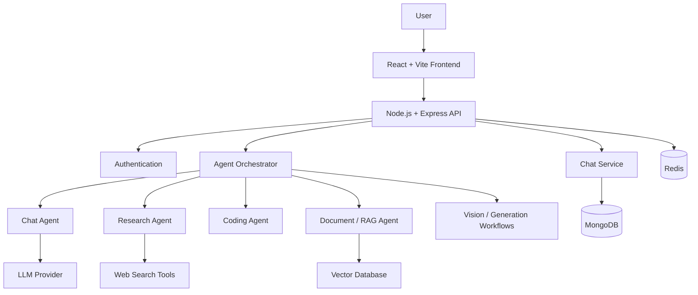

# 🧠 CortexAI — Your AI Workspace

**One intelligent workspace. Multiple specialized AI agents.**

CortexAI is a full-stack AI assistant platform designed to bring conversational AI, web research, coding assistance, document understanding, and content generation into one unified experience. Powered by large language models and an agent-orchestration workflow, CortexAI routes tasks to specialized capabilities based on user intent.

Instead of relying on a single conversational workflow, CortexAI combines AI-powered tools, retrieval-augmented generation (RAG), and contextual memory to support a wide range of tasks.

---

## ✨ Key Features

### 🤖 Intelligent AI Assistant
- Conversational AI powered by large language models.
- Task routing to specialized AI capabilities.
- Context-aware interactions for a more cohesive user experience.

### 🔍 Web Research
- Retrieve relevant information from web sources.
- Summarize search results into concise, useful responses.
- Support research-oriented queries through an AI-powered workflow.

### 💻 Coding Assistant
- Generate code from natural-language instructions.
- Help explain, debug, and improve existing code.
- Support development workflows through specialized coding capabilities.

### 📚 Document Intelligence & RAG
- Process PDF documents and extract relevant information.
- Split documents into manageable chunks.
- Generate embeddings for semantic retrieval.
- Retrieve relevant context using vector similarity search.
- Ground AI responses in retrieved document content.

### 🧠 Agent Orchestration
- Route user requests to appropriate AI workflows.
- Coordinate multi-step tasks through graph-based orchestration.
- Maintain workflow state and pass relevant context between steps.

### 🖼️ Multimodal AI
- Support image understanding and vision-based queries.
- Enable image generation through supported AI models.
- Extend interactions beyond text-only conversations.

### 📄 AI-Powered Content Generation
- Generate structured content and documents.
- Support presentation generation and downloadable artifacts.
- Process user requests through task-specific workflows.

### 🔐 Authentication & Data Management
- Firebase-based authentication.
- MongoDB-backed application data persistence.
- Redis-based session or conversational state management, where configured.

---

## 🏗️ System Architecture

CortexAI is designed around a modular architecture that separates the user interface, API layer, application services, and AI orchestration.

*Conceptual architecture: actual service boundaries and integrations depend on the configured implementation.*

### Request Lifecycle

1. The user submits a prompt through the frontend.
2. The backend receives and validates the request.
3. The orchestration layer determines the appropriate AI workflow.
4. The selected agent invokes the required model, tool, or retrieval pipeline.
5. Relevant context and retrieved information are incorporated into the response.
6. The result is returned to the frontend, with application data persisted where configured.

---

## 🛠️ Technology Stack

| Layer | Technologies |
|---|---|
| Frontend | React.js, Vite, JavaScript |
| Backend | Node.js, Express.js, REST APIs |
| AI & LLMs | Google Gemini and compatible model integrations |
| Agent Orchestration | LangChain
